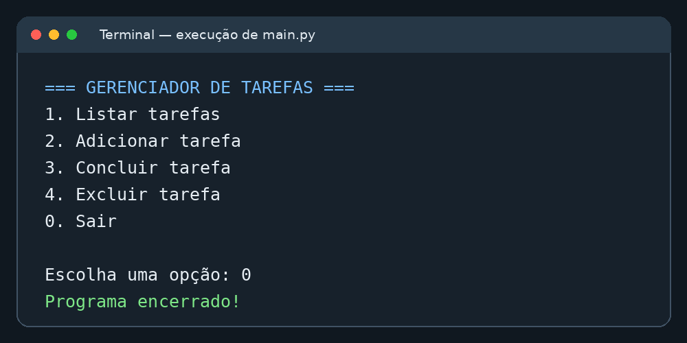

# Gerenciador de Tarefas em Python

[](https://github.com/gabrielle-software/gerenciador-de-tarefas/actions/workflows/tests.yml)

Um projeto desenvolvido em Python para praticar lógica de programação, organização de código, manipulação de arquivos e persistência de dados.

O programa permite adicionar, listar, concluir e excluir tarefas por meio de um menu interativo no terminal. As informações são armazenadas em um arquivo JSON, para que as tarefas continuem disponíveis entre as execuções.

## Prévia do menu



## Funcionalidades

- **Adicionar tarefas:** cadastra tarefas com uma descrição.
- **Listar tarefas:** exibe as tarefas cadastradas e seus status.
- **Concluir tarefas:** marca uma tarefa como concluída.
- **Excluir tarefas:** remove uma tarefa cadastrada.
- **Persistência de dados:** salva e carrega as tarefas em um arquivo JSON.
- **Validação de entradas:** trata descrições vazias, números inválidos e opções incorretas do menu.
- **Tratamento de falhas ao salvar:** informa quando ocorre um erro de gravação e só confirma alterações após o salvamento bem-sucedido.

## Tecnologias utilizadas

- Python 3
- JSON para armazenamento dos dados
- `pathlib` para manipulação de caminhos e arquivos
- `unittest` para testes automatizados
- Git e GitHub para versionamento e hospedagem do projeto
- GitHub Actions para execução automatizada dos testes

## Como executar o projeto

### Pré-requisitos

- Python 3 instalado.

### Instalação e execução

1. Clone este repositório:

```bash
git clone https://github.com/gabrielle-software/gerenciador-de-tarefas.git
```

2. Acesse a pasta do projeto:

```bash
cd gerenciador-de-tarefas
```

3. Execute o programa:

```bash
python main.py
```

No Windows, também é possível usar `py main.py`. Em alguns sistemas Linux, pode ser necessário usar `python3 main.py`.

## Armazenamento de dados

As tarefas são armazenadas no arquivo `tarefas.json`, criado na pasta do projeto quando uma tarefa é salva pela primeira vez.

## Testes automatizados

O projeto possui **9 testes automatizados** escritos com a biblioteca `unittest`. Eles verificam:

1. Se o programa retorna uma lista vazia quando o arquivo de tarefas ainda não existe.
2. Se tarefas são carregadas corretamente a partir de um JSON válido.
3. Se um JSON inválido é tratado sem interromper o programa.
4. Se as tarefas são salvas corretamente no formato JSON.
5. Se o programa informa quando não há tarefas cadastradas.
6. Se a listagem apresenta corretamente a descrição e o status das tarefas.
7. Se o fluxo de adicionar, concluir e excluir uma tarefa funciona como esperado.
8. Se uma falha de gravação é informada corretamente.
9. Se o programa não confirma a adição de uma tarefa quando o salvamento falha.

Para executar os testes localmente, use:

```bash
python -m unittest -v
```

### Integração contínua

O GitHub Actions executa os testes automaticamente em atualizações (*push*) e em solicitações de alteração (*pull requests*) direcionadas à branch `main`. O workflow utiliza Python 3.12 e executa o comando `python -m unittest -v`.

O selo no início deste README mostra o status mais recente do workflow. [Consulte as execuções dos testes no GitHub Actions](https://github.com/gabrielle-software/gerenciador-de-tarefas/actions).

## Objetivo de aprendizagem

Este projeto faz parte da minha formação em Engenharia de Software. Seu desenvolvimento contribui para a prática de Python, lógica de programação, organização de código, persistência de dados e testes automatizados.

---

Desenvolvido por **Gabrielle Sousa**.

---

# English Version

## Python Task Manager

A Python project created to practice programming logic, code organization, file handling, and data persistence.

The application allows users to add, list, complete, and delete tasks through an interactive terminal menu. Task data is stored in a JSON file and remains available between program executions.

## Menu Preview


## Features

- **Add tasks:** creates tasks with a description.
- **List tasks:** displays saved tasks and their status.
- **Complete tasks:** marks a task as completed.
- **Delete tasks:** removes a saved task.
- **Data persistence:** saves and loads tasks using a JSON file.
- **Input validation:** handles empty descriptions, invalid numbers, and incorrect menu options.

## Technologies Used

- Python 3
- JSON for data storage
- `pathlib` for file and path handling
- `unittest` for automated testing
- Git and GitHub for version control and project hosting
- GitHub Actions for automated test execution

## How to Run

### Requirements

- Python 3 installed on your computer.

### Installation and Execution

1. Clone this repository:

```bash
git clone https://github.com/gabrielle-software/gerenciador-de-tarefas.git
```

2. Navigate to the project folder:

```bash
cd gerenciador-de-tarefas
```

3. Run the application:

```bash
python main.py
```

On Windows, you can also use `py main.py`. On some Linux systems, you may need to use `python3 main.py`.

## Data Storage

Tasks are stored in a `tarefas.json` file, which is created in the project directory when a task is saved for the first time.

## Automated Tests

The project includes **9 automated tests** written with Python's `unittest` library. They check:

1. Whether the application returns an empty list when the task file does not exist.
2. Whether tasks are correctly loaded from valid JSON.
3. Whether invalid JSON is handled without interrupting the application.
4. Whether tasks are correctly saved in JSON format.
5. Whether the application reports when there are no registered tasks.
6. Whether the task list displays each description and status correctly.
7. Whether the workflow for adding, completing, and deleting a task works as expected.
8. Whether a file-saving failure is reported correctly.
9. Whether the application avoids confirming a task addition when saving fails.

To run the tests locally:

```bash
python -m unittest -v
```

### Continuous Integration

GitHub Actions automatically runs the tests on pushes and pull requests targeting the `main` branch. The workflow uses Python 3.12 and runs `python -m unittest -v`.

The badge at the top of this README displays the latest workflow status. [View test runs on GitHub Actions](https://github.com/gabrielle-software/gerenciador-de-tarefas/actions).

## Learning Goals

This project is part of my Software Engineering studies. It helps me develop practical skills in Python, programming logic, code organization, data persistence, and automated testing.

---

Developed by **Gabrielle Sousa**.
